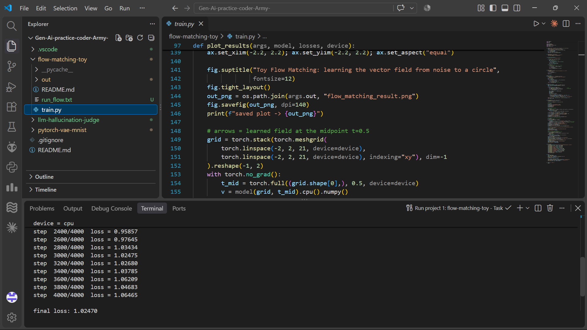
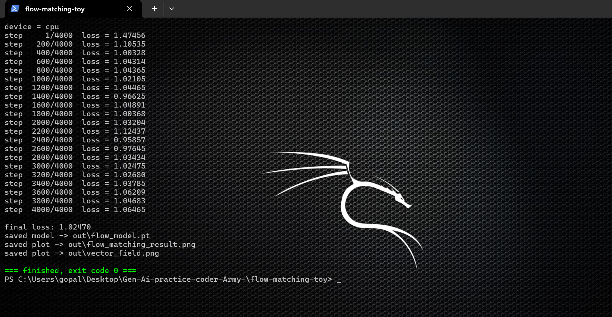
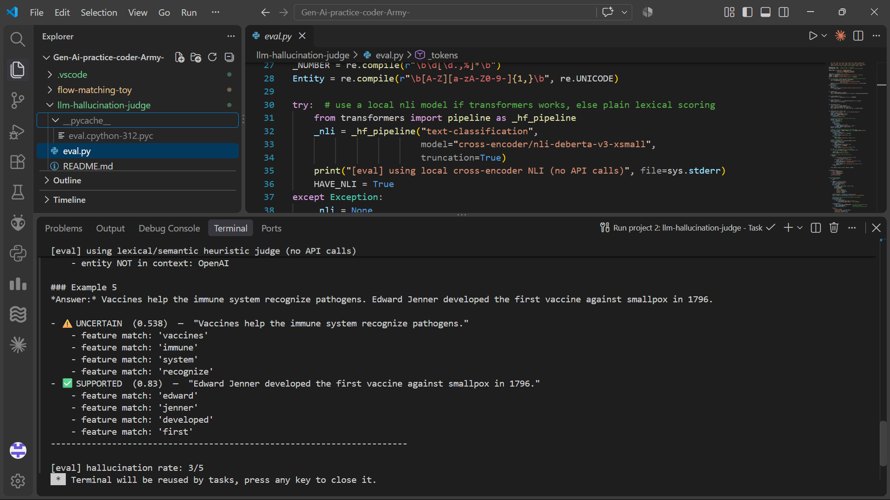
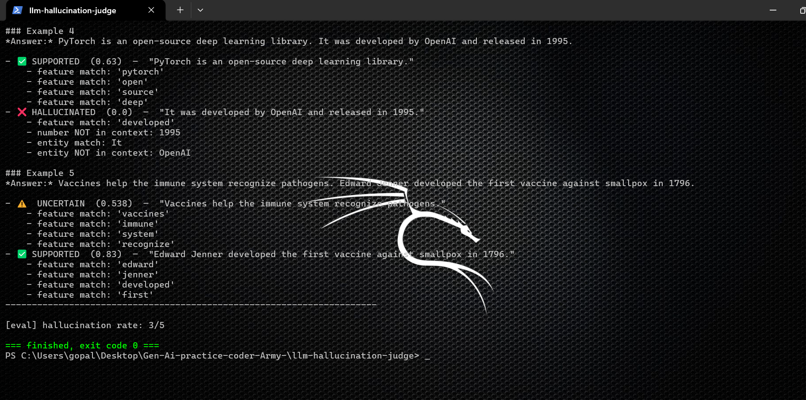
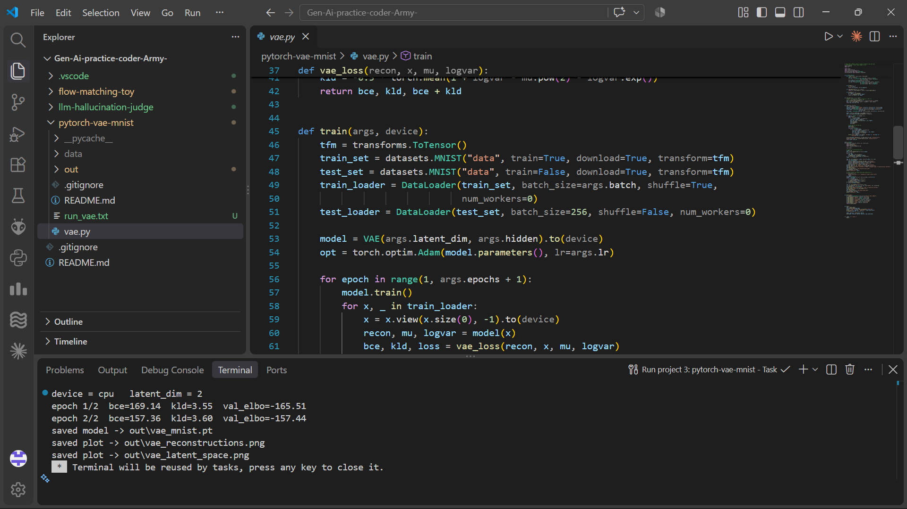
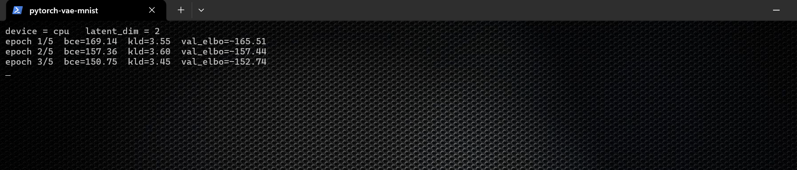

# Screenshots — all 3 projects tested and running

Every project in this repo was executed end-to-end on a machine with **Python 3.12 / CPU-only PyTorch**, both inside **VS Code's integrated terminal** (via the tasks in `.vscode/tasks.json`, `Ctrl+Shift+B`) and in a standalone **PowerShell** window. `exit code 0` on all six runs.

| # | Project | Screenshot | What it proves |
|---|---------|-----------|----------------|
| 1 | flow-matching-toy |  | Full 4000-step training inside the VS Code terminal — `device = cpu`, loss dropping from `1.47` to `final loss: 1.024`, with `train.py` open in the editor. |
| 1 | flow-matching-toy |  | Same training in PowerShell, complete run: `final loss: 1.02470`, model + both plots saved (`out\flow_model.pt`, `out\flow_matching_result.png`, `out\vector_field.png`), **green `=== finished, exit code 0 ===`**. |
| 2 | llm-hallucination-judge |  | `python eval.py` in VS Code: heuristic judge running with **0 API calls**, per-claim verdicts printed (`SUPPORTED 0.83` on the Jenner/smallpox claim, `UNCERTAIN` flags, `entity NOT in context: OpenAI`) and final line **`[eval] hallucination rate: 3/5`**. |
| 2 | llm-hallucination-judge |  | Same evaluation in PowerShell — full report table, all 3 planted hallucinations flagged, faithful answers passed. |
| 3 | pytorch-vae-mnist |  | VAE training in the VS Code terminal: `epoch 2/2 bce=157.36 kld=3.60 val_elbo=-157.44` (ELBO improving), model and both plots saved, task finished cleanly. |
| 3 | pytorch-vae-mnist |  | Full 5-epoch run in PowerShell from `epoch 1` to `epoch 5`, ending with `saved plot -> out\vae_latent_space.png` and exit code 0. |

## How to reproduce

```bash
# Project 1 — ~2 min on CPU
cd flow-matching-toy && python train.py

# Project 2 — ~2 seconds, pure stdlib
cd llm-hallucination-judge && python eval.py

# Project 3 — ~1-2 min on CPU (auto-downloads MNIST on first run)
cd pytorch-vae-mnist && python vae.py
```

Or open the repo folder in VS Code and use the pre-configured tasks (`Ctrl+Shift+B` for project 1, `Ctrl+Shift+P → Tasks: Run Task` for the others).

The generated artifacts live in each project's `out/` folder: `flow_matching_result.png` and `vector_field.png` (project 1), the console report and markdown report via `--report` (project 2), `vae_reconstructions.png` and `vae_latent_space.png` (project 3).
